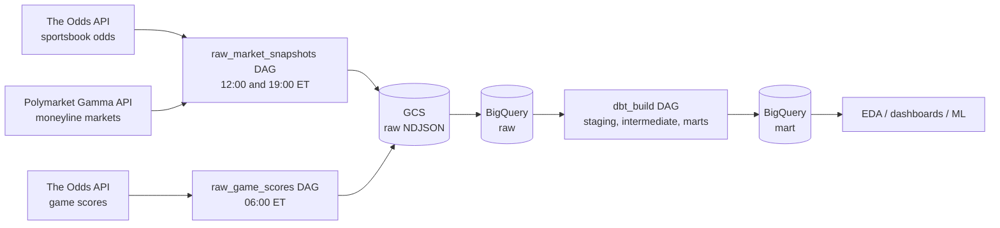

# BA882 Team 8 project: Sportsbooks vs. Prediction Markets

Fall 2026 team project for BA882.

We compare how **traditional sportsbooks** (DraftKings, FanDuel, etc., via [The Odds API](https://the-odds-api.com)) and the **Polymarket** prediction market price the same **NBA and NHL games. An automated pipeline snapshots both venues twice a day, lines them up game by game, and loads them into BigQuery. From there we can measure how far apart the two venues are, how the gap changes as a game approaches, and which venue turns out to be more accurate.

---

## Architecture



- **Orchestration:** Apache Airflow 3.3 on Astronomer (Astro Runtime)
- **Storage:** Google Cloud Storage (raw files) and BigQuery (warehouse)
- **Transformation:** dbt (BigQuery adapter), run from Airflow with Astronomer Cosmos
- **CI:** GitHub Actions on every pull request to `main`

---

## Data sources

| Source | What we pull | Endpoint | Auth |
|---|---|---|---|
| The Odds API | Head-to-head (moneyline) odds from US sportsbooks, decimal format | `/v4/sports/{sport}/odds` | API key |
| The Odds API | Final scores for the past day | `/v4/sports/{sport}/scores` | API key |
| Polymarket | Open moneyline markets for each league | `gamma-api.polymarket.com/events` | None |

**Leagues:** NBA (`basketball_nba`), NHL (`icehockey_nhl`), NFL (`americanfootball_nfl`)

### Odds API request budget

The free tier allows **500 requests per month**. The current schedule uses about 12 requests per day (around 370 per month):

- `raw_market_snapshots`: 2 runs x 3 leagues x 1 request = 6 per day
- `raw_game_scores`: 1 run x 3 leagues x 2 requests = 6 per day

**Please do not trigger the DAGs manually unless you need to.** Every manual run uses up part of the monthly budget. The remaining quota is printed in the task logs (`requests remaining=...`).

---

## Repository structure

```
.
├── dags/                         # Airflow DAGs
│   ├── raw_market_snapshots.py   # odds + Polymarket snapshots -> GCS -> raw.market_snapshots
│   ├── raw_game_scores.py        # daily scores -> GCS -> raw.game_scores
│   └── dbt_build.py              # runs dbt after each snapshot run (Cosmos)
├── include/
│   ├── ingest/                   # API clients used by the DAGs
│   │   ├── http.py               # shared GET with retry/backoff on HTTP 429
│   │   ├── odds_api.py           # fetch_odds, fetch_scores
│   │   └── markets.py            # fetch_polymarket (moneyline markets only)
│   └── dbt/                      # dbt project (see "dbt models" below)
├── tests/dags/                   # pytest DAG checks (imports, tags, retries)
├── .github/workflows/ci.yml      # CI: dbt parse + pytest on every PR
├── Dockerfile                    # Astro Runtime + separate venv for dbt
├── requirements.txt              # Airflow Python dependencies
├── .env.example                  # template for local environment variables
├── docs/  functions/  reporting/  setup/   # placeholders for later phases
```

---

## Pipeline

### Airflow DAGs

| DAG | Schedule (ET) | What it does |
|---|---|---|
| `raw_market_snapshots` | 12:00 and 19:00 daily | For each venue x league (6 tasks), fetches current prices, writes gzipped NDJSON to `gs://$GCS_BUCKET/raw/venue=.../league=.../dt=.../`, and appends to `raw.market_snapshots`. When done, emits the `raw_market_snapshots` Airflow Asset. |
| `raw_game_scores` | 06:00 daily | Fetches the previous day's scores for each league, writes to `gs://$GCS_BUCKET/raw/scores/...`, and appends to `raw.game_scores`. |
| `dbt_build` | Triggered by the `raw_market_snapshots` Asset | Runs `dbt build` (seeds, models, tests) through Cosmos. |

All DAGs use `catchup=False`, `max_active_runs=1`, and 2 retries with a 5-minute delay. Raw tables store each API record as a JSON string in a `payload` column, and all parsing happens in dbt.

### dbt models

Staging and intermediate models are views in the `staging` dataset. Marts are tables in the `mart` dataset.

| Layer | Model | Description |
|---|---|---|
| staging | `stg_oddsapi_book_prices` | One row per snapshot x game x bookmaker x team, with decimal odds and implied probability (1 / odds) |
| staging | `stg_polymarket_markets` | One row per snapshot x market x team, with bid, ask and last price |
| staging | `stg_oddsapi_results` | Latest completed score for each game (home and away score) |
| intermediate | `int_oddsapi_consensus` | Removes each book's margin (devig) so both sides sum to 1, then aggregates across books into one sportsbook consensus price per team (min, max, mean, number of books) |
| intermediate | `int_team_prices` | Unions sportsbook consensus and Polymarket, maps teams to canonical codes, builds a shared `matchup_code` (for example `BOS-NYK`), and computes mid and spread |
| mart | `fct_price_snapshot` | Full price history for both venues (incremental, partitioned by `game_date`) |
| mart | `fct_cross_venue_gap` | **Main analysis table.** Sportsbook vs. Polymarket mid price per game, team and hour, with `gap` and `abs_gap` (incremental) |
| mart | `dim_game` | One row per game, with which venues listed it and when it was first and last seen |
| mart | `fct_game_result` | Final result and winning team per game (incremental) |
| seed | `team_code_map` | Maps each venue's team identifier to one canonical team code per league |

Data tests live in `include/dbt/models/marts/schema.yml` (not-null, accepted values, uniqueness of the gap table).

**Joining the venues:** games are matched on `league + game_date + matchup_code`. `matchup_code` is the two canonical team codes sorted alphabetically, so it is the same on both venues. If a team name changes or is missing from `team_code_map.csv`, the `not_null` test on `int_oddsapi_consensus.team_code` will fail. See `include/dbt/seeds/README.md` for the verification notes and the list of unverified NHL names.

---

## Getting started

### Prerequisites

- [Astro CLI](https://www.astronomer.io/docs/astro/cli/install-cli) and Docker
- Access to the team GCP project and a service account key with GCS and BigQuery permissions
- An Odds API key

### One-time GCP setup

1. Create a GCS bucket for raw files.
2. Create a BigQuery dataset named `raw` (location `US`). The `raw.market_snapshots` and `raw.game_scores` tables are created automatically on the first load. dbt creates the `staging` and `mart` datasets.

### Local setup

```bash
git clone https://github.com/emisu36/ba882-team8-project.git
cd ba882-team8-project

cp .env.example .env
# edit .env: GCP_PROJECT, GCS_BUCKET, ODDS_API_KEY, GOOGLE_APPLICATION_CREDENTIALS
# put your service account key at the project root as sa-key.json (it is gitignored)

astro dev start        # Airflow UI at http://localhost:8080
```

### Environment variables

| Variable | Description |
|---|---|
| `GCP_PROJECT` | GCP project ID |
| `GCS_BUCKET` | Bucket for raw NDJSON files |
| `ODDS_API_KEY` | The Odds API key |
| `GOOGLE_APPLICATION_CREDENTIALS` | Full path to the service account key |
| `DBT_EXECUTABLE_PATH` | Optional. Path to the dbt executable (defaults to the venv built in the Dockerfile) |

On Astronomer these are set in the deployment's environment variables instead of `.env`. Never commit `.env` or `sa-key.json`.

### Running dbt by hand

dbt-bigquery and the Airflow Google provider need different versions of `google-cloud-storage`, so dbt runs in its own virtual environment:

```bash
python -m venv .venv-dbt
.venv-dbt/bin/pip install dbt-bigquery==1.12.1

cd include/dbt
../../.venv-dbt/bin/dbt deps  --profiles-dir .
../../.venv-dbt/bin/dbt build --profiles-dir .
```

To rebuild the incremental models from scratch inside Airflow, set the Airflow Variable `DBT_FULL_REFRESH=true` before the next `dbt_build` run, then set it back to `false`.

---

## Development workflow

1. Create a branch from `main` (for example `yourname/short-description`).
2. Open a pull request to `main`. CI runs `dbt parse --warn-error` and `pytest tests/`.
3. Get a review from a teammate, then merge.

DAG rules enforced by the tests: every DAG needs at least one tag and `retries >= 2`.

---

## Project status

- [x] Ingestion DAGs for The Odds API and Polymarket
- [x] Daily game scores DAG
- [x] dbt staging, intermediate and mart models, with tests
- [x] Automatic dbt runs after each snapshot (Cosmos)
- [x] CI on pull requests
- [ ] Astronomer deployment with environment variables and service account
- [ ] GCP resources (`raw` dataset, GCS bucket) created and first live run
- [ ] Auto-deploy from `main`
- [ ] EDA on `fct_cross_venue_gap` and `fct_game_result`
- [ ] Dashboard (`reporting/`)
- [ ] Machine learning phase

---

## Team
Li-Hsin Chang
Anton Falk
Yun-Hsuan Ku
Emily Su
Trong Khoi Thai


